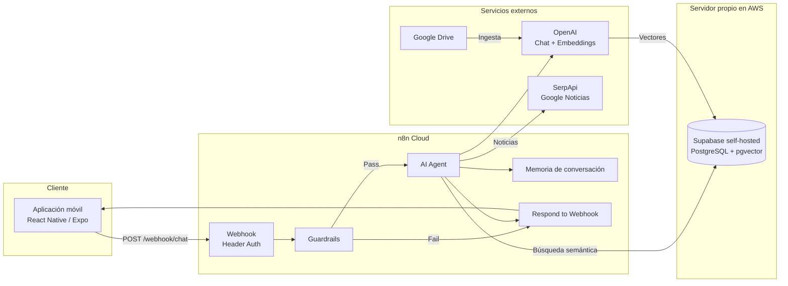

# Proyecto-N8N

# Asistente Virtual UNAB: Chatbot con Arquitectura RAG

Asistente conversacional para la Universidad Autónoma de Bucaramanga (UNAB), construido con una arquitectura de Generación Aumentada por Recuperación (RAG). El sistema responde preguntas a partir de documentos institucionales almacenados en una base de datos vectorial, aplica filtros de seguridad sobre los mensajes entrantes, consulta noticias actualizadas en la web y se expone a los usuarios mediante una aplicación móvil para Android.

## Tabla de contenido

1. [Descripción general](#descripción-general)
2. [Arquitectura](#arquitectura)
3. [Tecnologías utilizadas](#tecnologías-utilizadas)
4. [Base de datos](#base-de-datos)
5. [Pipeline de ingesta de documentos](#pipeline-de-ingesta-de-documentos)
6. [Flujo de consulta del chatbot](#flujo-de-consulta-del-chatbot)
7. [Seguridad y control de uso](#seguridad-y-control-de-uso)
8. [Aplicación móvil](#aplicación-móvil)
9. [Despliegue y configuración](#despliegue-y-configuración)
10. [Estructura del repositorio](#estructura-del-repositorio)
11. [Limitaciones conocidas](#limitaciones-conocidas)
12. [Trabajo futuro](#trabajo-futuro)
13. [Autores](#autores)

## Descripción general

Los modelos de lenguaje de propósito general no conocen la información interna de una institución ni los hechos posteriores a su entrenamiento. Este proyecto resuelve ese problema combinando tres elementos:

- Una **base de conocimiento vectorizada** con documentos de la universidad (costos, calendario, festivos, rutas del bus, cafeterías, edificios, entre otros), almacenada en PostgreSQL con la extensión pgvector.
- Un **agente basado en un modelo de lenguaje** que, antes de responder, recupera los fragmentos más relevantes de esa base de conocimiento y fundamenta su respuesta en ellos.
- Una **herramienta de búsqueda web** que permite responder preguntas sobre noticias y eventos recientes.

Todo el flujo de orquestación se implementó en n8n, sin necesidad de un backend desarrollado a medida. El cliente final es una aplicación móvil que envía la pregunta del usuario a un webhook y muestra la respuesta.

## Arquitectura

El sistema se compone de cuatro capas: almacenamiento, ingesta, orquestación y cliente.



### Capa de almacenamiento

Una instancia de Supabase desplegada de forma autoalojada (self-hosted) en un servidor de AWS mediante Docker Compose. Supabase proporciona PostgreSQL, el pooler de conexiones (Supavisor) y la interfaz de administración (Studio). La extensión `pgvector` habilita el almacenamiento y la búsqueda de vectores de alta dimensión.

### Capa de ingesta

Un workflow de n8n lee los archivos de una carpeta de Google Drive, los divide en fragmentos, genera sus embeddings con OpenAI y los inserta en la tabla vectorial.

### Capa de orquestación

Un segundo workflow de n8n expone un webhook autenticado, filtra los mensajes, ejecuta el agente con sus herramientas y devuelve la respuesta en formato JSON.

### Capa de cliente

Una aplicación móvil para Android desarrollada con React Native (Expo) que implementa la interfaz de chat.

## Tecnologías utilizadas

| Componente | Tecnología |
|---|---|
| Base de datos relacional y vectorial | Supabase (autoalojado), PostgreSQL, pgvector |
| Infraestructura | AWS (instancia EC2), Docker, Docker Compose |
| Orquestación y automatización | n8n (versión cloud) |
| Modelo de lenguaje | OpenAI `gpt-4o-mini` |
| Modelo de embeddings | OpenAI `text-embedding-3-small` (1536 dimensiones) |
| Framework de agentes | Nodos LangChain integrados en n8n (AI Agent, Vector Store, Text Splitter, Data Loader) |
| Búsqueda de noticias | SerpApi (Google Search / Google Noticias) |
| Fuente de documentos | Google Drive (API OAuth2) |
| Aplicación móvil | React Native, Expo |
| Compilación de la aplicación | EAS Build (Expo Application Services) |

## Base de datos

### Tabla vectorial

Los fragmentos de los documentos se almacenan en la tabla `documents`:

```sql
create extension if not exists vector;

create table if not exists documents (
  id        bigserial primary key,
  text      text,
  metadata  jsonb,
  embedding vector(1536)
);
```

| Columna | Descripción |
|---|---|
| `id` | Identificador del fragmento. |
| `text` | Contenido textual del fragmento. |
| `metadata` | Información en formato JSON: ubicación del fragmento dentro del documento y campo `fuente` con el nombre del archivo de origen. |
| `embedding` | Vector de 1536 dimensiones generado por el modelo de embeddings. |

La dimensión del vector debe coincidir con la del modelo de embeddings utilizado tanto en la ingesta como en la consulta. Usar modelos distintos en cada etapa produce resultados de recuperación incorrectos.

### Otras tablas

La base de datos incluye además tablas de datos estructurados (por ejemplo `calendario`, `cursos_estudiantes` y `noticias`), que por su naturaleza se consultan con SQL y no mediante búsqueda vectorial.

## Pipeline de ingesta de documentos

Workflow: **Embedding de documentos RAG**.

```
Disparador manual / programado
   -> Preparar tabla vectorial (Postgres, Execute Query)
   -> Buscar archivos en la carpeta (Google Drive, Search)
   -> Descargar archivo (Google Drive, Download)
   -> Postgres PGVector Store (Add documents to vector store)
         |-- Embeddings OpenAI (text-embedding-3-small)
         |-- Default Data Loader (tipo de dato: binario)
                 |-- Recursive Character Text Splitter
```

Detalles de configuración:

- **Búsqueda en Drive:** consulta con el identificador de la carpeta, `'<ID_CARPETA>' in parents and trashed = false`, con la opción de devolver todos los resultados.
- **Data Loader:** tipo de dato binario con detección automática del formato por tipo MIME. Se agrega el campo de metadatos `fuente` con el nombre del archivo para poder trazar el origen de cada fragmento y borrar fragmentos antiguos al reprocesar un documento.
- **Text Splitter:** `RecursiveCharacterTextSplitter` con un tamaño de fragmento de 1000 caracteres y un solapamiento de 200, valores de partida adecuados para texto estructurado en párrafos.
- **Almacenamiento:** el nodo PGVector Store inserta el texto, los metadatos y el vector en la tabla `documents`.

Para evitar duplicados al ejecutar la ingesta más de una vez, se recomienda borrar previamente los fragmentos del mismo archivo:

```sql
DELETE FROM documents WHERE metadata->>'fuente' = '<nombre_del_archivo>';
```

## Flujo de consulta del chatbot

Workflow: **Chatbot RAG**.

```
Webhook (POST, Header Auth)
   -> Guardrails
         |-- Fail -> Respond to Webhook (mensaje fijo)
         |-- Pass -> AI Agent
                        |-- Chat Model: OpenAI gpt-4o-mini
                        |-- Memory: Simple Memory (por sessionId)
                        |-- Tool: Postgres PGVector Store (recuperación)
                        |-- Tool: SerpApi (noticias)
                     -> Respond to Webhook (JSON)
```

### Contrato de la API

Solicitud:

```http
POST /webhook/chat
Content-Type: application/json
x-api-key: <clave>

{
  "mensaje": "¿Cuánto cuesta el semestre de Ingeniería de Sistemas?",
  "sessionId": "identificador-de-la-conversacion"
}
```

Respuesta:

```json
{
  "respuesta": "Texto generado por el asistente."
}
```

El campo `sessionId` permite que el agente mantenga el contexto de la conversación de cada usuario.

### Filtros de entrada (Guardrails)

Antes de llegar al agente, cada mensaje se evalúa con el nodo Guardrails de n8n. Se configuraron las siguientes comprobaciones:

- **Palabras clave:** lista de términos ofensivos, que no consume créditos de un modelo.
- **Jailbreak:** detección de intentos de modificar las instrucciones del sistema, con un umbral de confianza de 0.7.
- **Alineación temática:** restricción del alcance a temas de la universidad.

Los mensajes que no superan el filtro salen por la rama de fallo y reciben una respuesta fija sin invocar al agente, lo que reduce el costo y la superficie de ataque.

### Agente de recuperación

El AI Agent recibe un mensaje de sistema que le indica responder en español, consultar siempre la herramienta de búsqueda en documentos antes de contestar preguntas sobre la universidad, no inventar información y reconocer cuando un dato no aparece en las fuentes. La herramienta de recuperación realiza una búsqueda por similitud de coseno en `documents` y devuelve los fragmentos más cercanos (límite de 4), con sus metadatos, como contexto para el modelo.

### Noticias actualizadas

Para preguntas sobre hechos recientes, el agente utiliza la herramienta SerpApi configurada sobre Google Noticias, con país Colombia, idioma español y filtro temporal reciente. El mensaje de sistema incluye la fecha actual como una expresión dinámica, de modo que el agente pueda interpretar referencias como "hoy" o "ayer", e indica citar la fuente de cada noticia.

### Optimización de costos

Se diseñó un enrutamiento por puntaje de similitud previo al agente: cuando la coincidencia con un fragmento es muy alta, se responde con el contenido recuperado sin invocar al modelo de lenguaje, y cuando es muy baja, se informa que la consulta está fuera del alcance del asistente. Solo los casos intermedios llegan al agente. Los umbrales deben calibrarse con consultas reales, ya que dependen de si el valor devuelto es una distancia o una similitud.

## Seguridad y control de uso

- **Autenticación del webhook:** autenticación por cabecera (`x-api-key`) mediante credencial Header Auth de n8n.
- **Gestión de secretos:** las claves de OpenAI, SerpApi, Google y la contraseña de PostgreSQL residen únicamente como credenciales de n8n y en el archivo de entorno del servidor. Ninguna se incluye en el repositorio ni en la aplicación móvil, con la excepción de la clave del webhook.
- **Conexión a la base de datos:** acceso mediante el pooler de Supabase con un usuario con formato `postgres.<tenant>`. El puerto 5432 debe restringirse en el grupo de seguridad de AWS a las direcciones de salida de n8n.
- **Límite de gasto:** se recomienda establecer límites mensuales en OpenAI y SerpApi, y limitar el número de iteraciones del agente para evitar bucles de llamadas a herramientas.
- **Limitación conocida de la clave del cliente:** una clave estática embebida en una aplicación móvil puede ser extraída. Para un entorno de producción se recomienda autenticar a los usuarios (por ejemplo con Supabase Auth) y validar un token en el webhook.

## Aplicación móvil

Aplicación de chat desarrollada en React Native con Expo, en un único componente (`App.js`) sin dependencias adicionales.

Características:

- Interfaz de conversación con burbujas diferenciadas para el usuario y el asistente.
- Indicador de escritura mientras se espera la respuesta.
- Ajuste manual de la interfaz al aparecer el teclado.
- Identificador de sesión generado por cada apertura de la aplicación, para mantener la memoria del agente.
- Tiempo máximo de espera de 60 segundos y mensajes de error diferenciados (autenticación, servidor, respuesta inválida, tiempo agotado, conexión).
- Identidad visual con los colores institucionales de la UNAB (naranja y blanco), definidos en un objeto de constantes.

### Ejecución en desarrollo

```bash
npx create-expo-app@latest chat-unab --template blank
cd chat-unab
# Reemplazar App.js por el archivo de este repositorio y configurar las constantes
npx expo start
```

Se escanea el código QR con la aplicación Expo Go en un dispositivo conectado a la misma red.

### Generación del instalable para Android

La aplicación se compila en la nube con EAS Build y se obtiene un archivo APK instalable sin necesidad de Expo Go.

```bash
npm install -g eas-cli
eas login
eas build -p android --profile preview
```

El perfil `preview` está definido en `eas.json` con `buildType: apk`. Es necesario definir un identificador único del paquete (`android.package`) en `app.json`. La distribución para iOS requiere una cuenta de Apple Developer y no está cubierta en este proyecto.

## Despliegue y configuración

### Requisitos

- Servidor con Docker y Docker Compose (instancia EC2 de AWS).
- Cuenta de n8n (versión cloud o autoalojada).
- Cuenta de OpenAI con una clave de API.
- Cuenta de SerpApi con una clave de API.
- Proyecto de Google Cloud con credenciales OAuth2 para Google Drive.
- Node.js (versión LTS) para la aplicación móvil.

### Pasos

1. **Supabase autoalojado.** Desplegar Supabase con Docker Compose en el servidor. Definir el archivo `.env` con contraseñas seguras y anotar el valor de `POOLER_TENANT_ID`.
2. **Base de datos.** Ejecutar en el editor SQL el script de creación de la extensión `vector` y de la tabla `documents`.
3. **Red.** Abrir el puerto 5432 en el grupo de seguridad únicamente para las direcciones IP de salida de n8n.
4. **Credenciales en n8n.** Crear las credenciales de Postgres (host del servidor, base `postgres`, usuario `postgres.<tenant>`, puerto 5432), Google Drive (OAuth2), OpenAI, SerpApi y Header Auth.
5. **Ingesta.** Importar o construir el workflow de ingesta, configurar el identificador de la carpeta de Drive y ejecutarlo.
6. **Chatbot.** Importar o construir el workflow del chatbot, conectar los sub-nodos del agente y publicar el workflow.
7. **Aplicación.** Configurar en `App.js` la URL de producción del webhook (sin el sufijo `-test`) y la clave, y generar el APK.

Nota: la URL de prueba del webhook (`/webhook-test/`) solo responde una vez por cada ejecución manual en el editor. La aplicación debe apuntar siempre a la URL de producción, y el workflow debe estar publicado.

## Estructura del repositorio

```
.
├── README.md
├── app/
│   ├── App.js
│   ├── app.json
│   └── eas.json
├── n8n/
│   ├── ingesta-documentos.json
│   └── chatbot-rag.json
├── sql/
│   └── schema.sql
└── docs/
```

Los archivos JSON de los workflows deben exportarse de n8n sin credenciales ni valores sensibles. No se deben versionar archivos `.env`, claves de API ni contraseñas.

## Limitaciones conocidas

- La respuesta directa a partir de un fragmento recuperado devuelve un trozo de documento, no una respuesta redactada, por lo que es adecuada para datos puntuales y menos para preguntas amplias.
- La calidad de las respuestas depende de la calidad, la actualización y la cobertura de los documentos ingeridos.
- Los resultados de la búsqueda web pueden contener errores o fuentes de baja calidad.
- La memoria de conversación simple no persiste si el workflow se reinicia.
- La autenticación mediante clave estática no distingue entre usuarios.
- El tiempo de respuesta depende de la latencia combinada de la base de datos, el modelo de lenguaje y las herramientas externas.

## Trabajo futuro

- Autenticación de usuarios con Supabase Auth y validación de tokens en el webhook.
- Caché semántica de respuestas para reducir llamadas al modelo de lenguaje.
- Consulta de datos estructurados (calendario, cursos, estado académico) mediante herramientas SQL del agente.
- Memoria de conversación persistente en PostgreSQL.
- Actualización automática de la tabla de noticias mediante lectura de fuentes RSS.
- Evaluación sistemática de la calidad de las respuestas con un conjunto de preguntas de referencia.
- Publicación de la aplicación en Google Play.

## Autores

- Nombre del autor 1
- Nombre del autor 2

Universidad Autónoma de Bucaramanga, Ingeniería de Sistemas.
